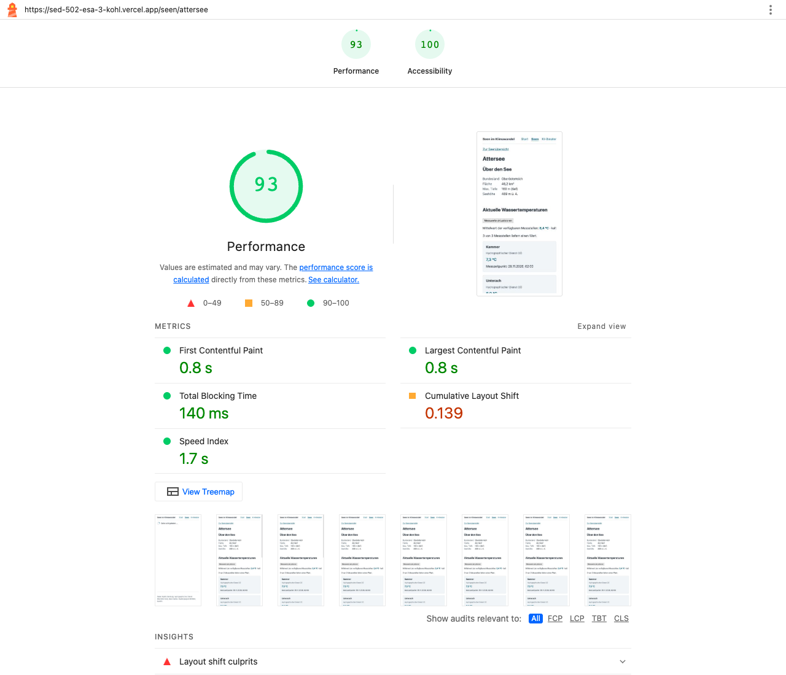
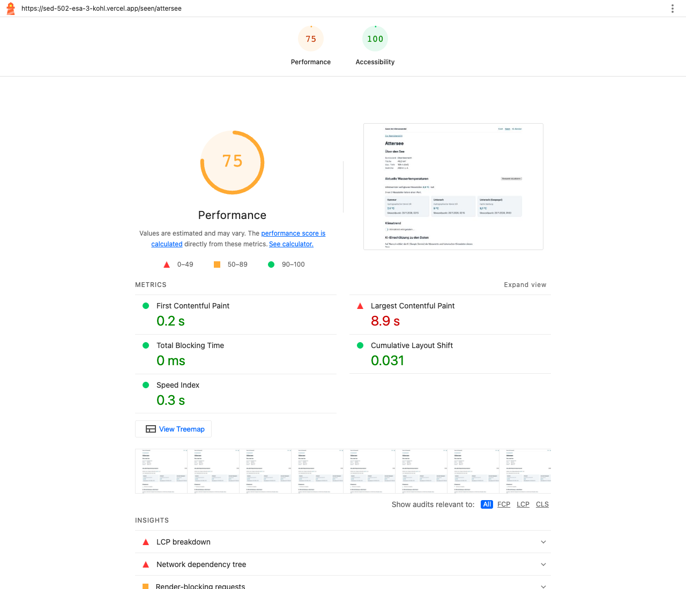

# Lighthouse-Ausgangsmessung

## Messbedingungen

- Datum **28.11.2026**, Beginn der Läufe von **10:24 bis 10:30 JST** (01:24 bis 01:30 UTC).
- Produktion unter <https://sed-502-esa-3-kohl.vercel.app/>. Lokaler Ausgangsstand `a4f452a`, Merge von PR #6. Die Namen und unkomprimierten Größen der geprüften Haupt-JS-, CSS- und Diagrammdateien stimmen mit dem lokalen Build überein.
- **Lighthouse 13.6.0**, **Chrome 158.0.0.0**, **Node 26.13.1**, macOS. Die installierten Werkzeuge liegen außerhalb des Repositorys.
- Navigation über die Lighthouse-CLI mit Headless Chrome im Inkognito-Modus. Jeder Lauf startet mit einem frischen Browserprofil und zurückgesetztem Browser-Speicher. Dies automatisiert die Messreihe aus Abschnitt 6 der Planung. Das CDN und die Datenanbieter können zwischen Läufen weiterhin serverseitig zwischenspeichern.
- Mobil mit **412 × 823 CSS-Pixeln**, simuliertem Netzwerk mit 150 ms RTT und 1.638,4 kbit/s sowie vierfacher CPU-Verlangsamung. Desktop mit **1.350 × 940 CSS-Pixeln**, 40 ms RTT und 10.240 kbit/s ohne CPU-Verlangsamung. Dies sind die Standardprofile dieser Lighthouse-Version.
- Je Seite und Gerät **drei Läufe nacheinander**, insgesamt 24. Gemessen wurden Performance und Accessibility. Für jede Tabellenspalte wird der Median ihrer drei Werte separat berechnet.
- Echte Mess-, Wetter- und Klimadaten. In den aufgezeichneten Netzwerkanfragen traten keine HTTP-Fehler auf. Auf der Detailseite wurden in allen sechs Läufen die historischen Daten und der Diagrammchunk geladen. Die KI wurde nicht angefordert.
- Gemessen wird der erste Seitenaufruf. LCP beschreibt die Zeit bis zum größten sichtbaren Inhalt, CLS die Layoutverschiebung und TBT blockierte Zeit im Hauptthread. **INP erfordert Interaktionen und wurde in dieser Navigationsmessung nicht erfasst.**

## Mediane

| Seite | Gerät | Performance | Accessibility | LCP (s) | TBT (ms) | CLS |
| --- | --- | ---: | ---: | ---: | ---: | ---: |
| Start | Mobil | 95 | 100 | 1,26 | 0 | 0,131 |
| Start | Desktop | 100 | 100 | 0,33 | 0 | 0,000 |
| Seenliste | Mobil | 95 | 100 | 1,24 | 20 | 0,139 |
| Seenliste | Desktop | 100 | 100 | 0,33 | 0 | 0,054 |
| Attersee | Mobil | 93 | 100 | 0,76 | 167 | 0,139 |
| Attersee | Desktop | 75 | 100 | 8,06 | 0 | 0,031 |
| KI-Berater | Mobil | 99 | 100 | 1,38 | 0 | 0,070 |
| KI-Berater | Desktop | 100 | 100 | 0,34 | 0 | 0,005 |

Alle acht Kombinationen erreichen beim Median die ESA-3-Vorgabe von mindestens 70 Punkten für Performance und Accessibility. Der gesonderte Accessibility-Audit mit axe oder WAVE sowie die abschließende Prüfung mit Tastatur stehen noch aus.

## Einzelmessungen

| Seite | Gerät | Lauf | Performance | Accessibility | LCP (s) | TBT (ms) | CLS |
| --- | --- | ---: | ---: | ---: | ---: | ---: | ---: |
| Start | Mobil | 1 | 95 | 100 | 1,54 | 0 | 0,131 |
| Start | Mobil | 2 | 100 | 100 | 1,26 | 3 | 0,000 |
| Start | Mobil | 3 | 95 | 100 | 1,23 | 0 | 0,131 |
| Start | Desktop | 1 | 100 | 100 | 0,33 | 0 | 0,000 |
| Start | Desktop | 2 | 100 | 100 | 0,33 | 0 | 0,000 |
| Start | Desktop | 3 | 100 | 100 | 0,33 | 0 | 0,000 |
| Seenliste | Mobil | 1 | 100 | 100 | 1,46 | 81 | 0,000 |
| Seenliste | Mobil | 2 | 95 | 100 | 1,24 | 0 | 0,139 |
| Seenliste | Mobil | 3 | 95 | 100 | 1,23 | 20 | 0,139 |
| Seenliste | Desktop | 1 | 100 | 100 | 0,35 | 0 | 0,054 |
| Seenliste | Desktop | 2 | 100 | 100 | 0,33 | 0 | 0,054 |
| Seenliste | Desktop | 3 | 100 | 100 | 0,33 | 0 | 0,054 |
| Attersee | Mobil | 1 | 93 | 100 | 0,76 | 167 | 0,139 |
| Attersee | Mobil | 2 | 93 | 100 | 0,76 | 143 | 0,139 |
| Attersee | Mobil | 3 | 97 | 100 | 1,25 | 186 | 0,000 |
| Attersee | Desktop | 1 | 75 | 100 | 8,06 | 0 | 0,031 |
| Attersee | Desktop | 2 | 75 | 100 | 8,91 | 0 | 0,031 |
| Attersee | Desktop | 3 | 100 | 100 | 0,34 | 0 | 0,056 |
| KI-Berater | Mobil | 1 | 99 | 100 | 1,38 | 0 | 0,070 |
| KI-Berater | Mobil | 2 | 99 | 100 | 1,38 | 0 | 0,070 |
| KI-Berater | Mobil | 3 | 99 | 100 | 1,39 | 0 | 0,070 |
| KI-Berater | Desktop | 1 | 100 | 100 | 0,34 | 0 | 0,005 |
| KI-Berater | Desktop | 2 | 100 | 100 | 0,33 | 0 | 0,005 |
| KI-Berater | Desktop | 3 | 92 | 100 | 1,39 | 0 | 0,005 |

## Performance

### Bundle-Größen vor der Optimierung

`npm run build` läuft mit Node 26 fehlerfrei. Größen aus der Vite-Ausgabe in dezimalen kB. Der Diagrammchunk enthält die Diagrammkomponente und ihre gebündelten Abhängigkeiten.

| Datei | Unkomprimiert (kB) | Gzip (kB) |
| --- | ---: | ---: |
| `index-CE1cGc2m.js` | 270,75 | 86,19 |
| `KlimaDiagramm-RM8FW0dY.js` | 353,62 | 102,88 |
| `index-DAtvLo-w.css` | 8,03 | 2,37 |

Die Diagrammdatei wird auf der Detailseite bereits separat geladen, sobald die Klimadaten vorliegen. Eine Prüfung, ob das Diagramm sichtbar ist, fehlt noch.

### Befunde für den nächsten Optimierungsschritt

1. **Später Inhalt auf der Desktop-Detailseite.** Die drei Performance-Scores lauten 75, 75 und 100. Der Median des LCP beträgt 8,06 Sekunden. In den beiden langsameren Läufen nennt Lighthouse den erst nach den Klimadaten eingeblendeten Erklärungstext unter dem Diagramm als LCP-Element. Die starke Schwankung bleibt in den Einzelwerten sichtbar.
2. **Layoutsprünge beim Nachladen.** Auf Startseite und Seenliste liegen die mobilen CLS-Mediane bei 0,131 und 0,139. Lighthouse zeigt dabei die verschobene Fußzeile als betroffenes Element. Auf der Desktop-Detailseite verschiebt sich beim Einblenden des Diagramms außerdem die KI-Sektion. Im nächsten Schritt sind die Platzhalter für Seiteninhalt und Diagramm auf ausreichende Höhe zu prüfen.
3. **Diagramm und JavaScript.** Der Diagrammchunk wird auch mobil ohne Benutzerinteraktion angefordert. Wie geplant soll er erst bei Sichtbarkeit geladen werden. Lighthouse schätzt im Desktop-Detailbericht von Lauf 2 rund 82 kB an während der Messung ungenutztem JavaScript. Die Schätzung ist vor einer Änderung gegen die benötigten Funktionen zu prüfen.

Die Ausgangsmessung hält diese Befunde fest. Die nächste Messreihe ergänzt die tatsächlich umgesetzten Maßnahmen und die Größen nach der Optimierung.

### Umgesetzte Optimierungen am 28.11.2026

- `Klimatrend` beobachtet den 320 px hohen Grafikbereich mit `IntersectionObserver`. Erst wenn er sichtbar ist und Frosttage vorliegen, wird die Grafik per `React.lazy` geladen. Nach der ersten Sichtbarkeit wird der Observer getrennt. Ohne Browserunterstützung wird die Grafik bei vorhandenen Daten direkt geladen.
- Bildunterschrift, Erklärung, Quellenlink und Datentabelle liegen jetzt im bereits geladenen `Klimatrend`. Die Tabelle ist unabhängig vom Grafikchunk bedienbar. Der Grafikbereich bleibt auch während des Datenabrufs und des Nachladens der Grafik 320 px hoch.
- Der Hauptinhalt hat mindestens eine Bildschirmhöhe (`100svh`). Dadurch liegt die Fußzeile während des Ladens einer Seite bereits unterhalb des ersten Bildschirms. Bei kurzen Seiten entsteht entsprechend mehr Platz vor der Fußzeile.

Die Klimadaten werden weiterhin beim Aufruf der Detailseite abgerufen. Die Verzögerung betrifft das Laden und Rendern der Diagrammgrafik.

| Bundle | Vorher (kB) | Nachher (kB) | Gzip vorher / nachher (kB) |
| --- | ---: | ---: | ---: |
| Haupt-JavaScript | 270,75 | 270,75 | 86,19 / 86,19 |
| Diagrammgrafik | 353,62 | 352,03 | 102,88 / 102,29 |
| See-Detailseite | 8,01 | 10,11 | 3,20 / 3,89 |
| Stylesheet | 8,03 | 8,05 | 2,37 / 2,38 |

Die größere Detailseite enthält nun den Rahmen und die Tabelle. Bei einem zunächst außerhalb des Bildschirms liegenden Diagramm entfällt bis zum Scrollen der Abruf des rund 102 kB großen gzip-komprimierten Grafikchunks.

**Lokale Prüfung mit dem Produktions-Build und nachgebildeten API-Antworten.** Bei 320 px wurde vor dem Scrollen kein Grafikchunk angefordert. Nach dem Scrollen wurde die Grafik geladen. Bei 320 px und 1280 px blieb die Position der nachfolgenden KI-Sektion beim Eintreffen der Klimadaten stabil. Die Grafik war mit Pfeiltasten bedienbar und die Tabelle ließ sich per Enter öffnen und per Tab fokussieren. Ohne `IntersectionObserver` sowie nach einem fehlgeschlagenen Abruf mit anschließendem Wiederholen wurde die Grafik ebenfalls angezeigt. Es gab keine horizontalen Scrollbalken oder JavaScript-Fehler.

`npm run build`, `npm run lint` und alle 196 vorhandenen Tests sind erfolgreich. Die oben dokumentierten Lighthouse-Scores gehören weiterhin zur Ausgangsmessung auf Produktion. Eine erneute Live-Messung folgt nach dem Deployment dieser Änderungen.

## Screenshots

Die Screenshots zeigen jeweils Lauf 2 der Attersee-Detailseite mit den beiden Kategorie-Scores. Beide Läufe haben den jeweiligen Performance-Median. LCP, TBT und CLS in der Mediantabelle können aus anderen Läufen stammen.





## Messung wiederholen

Für einen einzelnen mobilen Lauf kann die CLI mit derselben Version ausgeführt werden. Der Befehl benötigt installiertes Chrome. Für Desktop zusätzlich `--preset=desktop` anfügen. Für jede der vier Routen `/`, `/seen`, `/seen/attersee` und `/berater` je drei Läufe pro Gerät durchführen.

```bash
npx --yes lighthouse@13.6.0 https://sed-502-esa-3-kohl.vercel.app/seen/attersee \
  --only-categories=performance,accessibility \
  --chrome-flags="--headless --incognito --no-first-run" \
  --output=html --output=json --output-path=/tmp/esa3-attersee-mobil-1 \
  --no-enable-error-reporting
```

Die CLI und die Bedienung über Chrome DevTools beschreibt die [offizielle Lighthouse-Anleitung](https://developer.chrome.com/docs/lighthouse/overview). Bei späteren Vergleichsmessungen dieselbe Lighthouse-Version, dieselben Profile und dieselbe Produktions-URL verwenden und Änderungen der Messumgebung festhalten.
